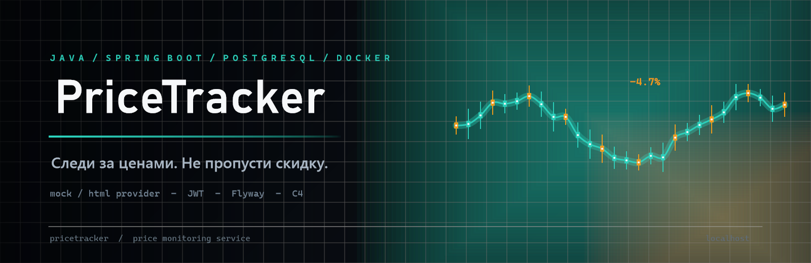

# PriceTracker — поиск дешевле и локальный конфигуратор сборок



Stack: **Java 17 + Spring Boot 3.3 + Thymeleaf + Flyway + PostgreSQL 16 + nginx**.
Python, Node.js и Next.js не используются: страницы — серверные шаблоны, анимации — CSS.

На странице `/cheaper` работают два режима:
1. **Поиск дешевле:** по одной ссылке на товар в DNS-Shop, М.Видео, Ситилинке, Ozon,
   Wildberries или любом другом магазине ищется **та же или лучшая конфигурация дешевле**.
2. **Экспертный конфигуратор:** по бюджету, назначению, приоритету, пожеланиям и региону
   подбирается совместимая сборка ПК/ноутбука; для каждой детали ищутся 2–3 предложения
   с магазином, ценой, наличием и ссылкой.
3. **Подбор ноутбука (`category=laptop`):** сравнение 3–5 конкретных моделей с артикулом,
   бенчмарками, экраном, автономностью, портами, апгрейдом и подводными камнями;
   отчёт включает топ-1, альтернативы, сравнение цен и прогноз на 3–5 лет.
   Входные поля: бюджет, назначение, приоритет, размер экрана, ОС, особые требования, регион.

Найденные карточки и собранные конфигурации — разовые отчёты; в отслеживание они не добавляются.
Если магазины блокируют парсер, цены честно помечаются как демо и сопровождаются ссылкой на поиск.

## Запуск

```powershell
cd "C:\Users\user\Desktop\project DevOPs\pricetracker"

$dbPass = [guid]::NewGuid().ToString("N")
$jwtKey = [guid]::NewGuid().ToString("N") + [guid]::NewGuid().ToString("N")
@"
POSTGRES_DB=pricetracker
POSTGRES_USER=ptuser
POSTGRES_PASSWORD=$dbPass
POSTGRES_PORT=5432
JWT_SECRET=$jwtKey
ACCESS_TOKEN_TTL_MINUTES=120
SPEC_PROVIDER=mock
APP_PORT=80
"@ | Set-Content .env -Encoding utf8

docker compose up --build -d
docker compose ps -a
```

Открыть: **http://localhost** → `/cheaper`.

**Регистрация закрыта.** Вход по готовым аккаунтам из миграции `V3__demo_users.sql`:
- `demo@example.com` / `demopass123`
- `student@example.com` / `qwerty123`

## Быстрый запуск одним кликом (Windows)

Двойной клик по `PriceTracker.exe` в корне проекта: проверит Docker Desktop, выполнит
`docker compose up -d`, дождётся `{"status":"UP"}` и откроет `http://localhost`.
Без браузера: `.\PriceTracker.exe --no-open`. Исходник: `tools/launcher/README.md`.

## Сервисы

| Сервис | Папка | Ответственность | API |
|---|---|---|---|
| `db` | `services/db` | PostgreSQL 16, volume `db_data` | SQL :5432 |
| `migrate` | `services/migrate` | Flyway V1–V4, one-shot | CLI / Flyway |
| `app` | `services/app` | REST API + Thymeleaf UI + поиск дешевле и конфигуратор | `/api/**`, `/cheaper`, `/actuator/**` |
| `nginx` | `services/nginx` | reverse proxy, точка входа :80 | `/`, `/api/` |

У каждого сервиса есть `Dockerfile` и `README.md` в `services/<имя>/`.

## Сценарий

1. Войти под демо-аккаунтом.
2. Вставить ссылку на сборку ПК/ноутбук/телефон/наушники, выбрать тему и число предложений (1–10).
3. Выбрать «Искать во всех магазинах» или «Только магазин из ссылки».
4. Получить вердикт и наглядную матрицу сравнения комплектаций: для ПК это CPU, GPU, RAM, SSD,
   БП, охлаждение, ОС и корпус — с иконками, весами и шкалами баллов. Ссылки на магазины
   находятся в заголовках столбцов таблицы.
5. Либо во второй форме указать бюджет, назначение (игры/работа/монтаж/3D/стриминг/учёба/
   универсальное), приоритет (производительность/тишина/компактность/апгрейд), пожелания
   и регион. Конфигуратор покажет таблицу компонентов с 2–3 предложениями на деталь,
   итог vs бюджет, обоснование, инструкцию сборки, узкие места и альтернативу +12%.

`StoreRegistry` определяет магазин по хосту. `StoreOffersSource` запрашивает поисковую страницу
магазина и (при `crossStore=true`) других магазинов, запасной канал — Bing.
`StoreProductParser` разбирает JSON-LD/DOM, `ConfigExtractor` вытаскивает CPU/GPU/RAM/SSD/БП/
охлаждение/ОС/корпус, а `SameConfigMatcher` пропускает только не худшую комплектацию
со строго меньшей ценой.
Характеристики исходника не подменяются характеристиками найденной карточки — иначе любая
страница считалась бы «той же сборкой».

Если сайт блокирует бота (HTTP 401/429, SPA-оболочка), подключается `DemoCheaperSource`
с искусственно заниженными ценами и честным предупреждением в `warnings`. Такие карточки
помечены бейджем `ДЕМО-ЦЕНА` в UI и полем `"demo": true` в API; ссылка ведёт на реальный поиск
конфигурации в магазине, где цену нужно проверить вручную.

Скоринг переиспользует `ComparisonService.evaluate`: веса из `CategoryCatalog` для четырёх тем
(`laptop`, `phone`, `headphones`, `pc`), а в вердикте и таблице показываются две оценки по шкале
0–10 — за конфигурацию и за цену/качество. Поиск ничего не пишет в БД.

Конфигуратор работает без внешней языковой модели: `PartCatalog` задаёт каталог деталей
с сокетом, чипсетом, TDP, габаритами и базовыми ценами; `BuildService` распределяет бюджет
по компонентам, проверяет сокет, чипсет, тип памяти, запас БП, длину видеокарты, высоту кулера
и баланс CPU/GPU; `PartPriceService` параллельно ищет по 2–3 предложения на каждую деталь.
Посторонние карточки отсекаются проверкой цены и совпадения модели. Если сайт блокирует парсер,
показываются демо-предложения с бейджем `ДЕМО` и ссылкой на реальный поиск. Превышение бюджета
более чем на 3% запрещено; альтернативная сборка строится в пределах +12%. Оценки — 0–10.

## Фон и темы интерфейса

Тяжёлый полноэкранный фон с изолиниями (`contours-wide.svg` / `contours-tall.svg`, генератор
на `noise()` + Marching Squares) удалён вместе с SVG-ассетами. Теперь фон — сплошной цвет из
переменной `--bg`, а декоративный слой рисуется чисто CSS:

- светлая тема — пастельные точки через `radial-gradient`;
- тёмная тема — тонкие диагональные штрихи через `repeating-linear-gradient`.

Оба слоя находятся в `body::before` / `body::after`, имеют низкую непрозрачность
(`--pattern-opacity`) и плавно crossfade-ятся через `opacity` за 200 мс. Кнопка в правом верхнем
углу переключает `data-theme` на `<html>`; выбор сохраняется в `localStorage`, а при первом
визите учитывается `prefers-color-scheme`. Логика — в `static/theme.js`, палитры — в `:root`
и `[data-theme="dark"]` файла `static/style.css`.

Анимации используют только `transform` и `opacity`; `blur`, `filter`, большие `box-shadow`
и внешние шрифты убраны. `will-change` стоит точечно — только на кнопке темы.

Все действия форм выровнены к единой геометрии: радио-варианты «Искать во всех магазинах» /
«Только магазин из ссылки» и кнопки «Найти дешевле» / «Собрать и узнать цену» имеют размер
240 × 38 px, а ссылки «Открыть» в таблицах оформлены такими же кнопками 38 × 96 px.
Выбранный радио-вариант подсвечивается акцентом; на узком экране варианты переносятся.

## Кэш, метрики и прозрачность отчёта

- Ответы `/api/cheaper`, `/api/build` и `/api/laptops` кэшируются в памяти **12 минут**
  (`CACHE_TTL_MINUTES`) с ключом из нормализованных параметров запроса: регистр, порядок
  параметров URL и лишние пробелы не создают копии. Лимит — 200 записей
  (`CACHE_MAX_ENTRIES`), старые вытесняются. Кэш общий для UI и API: повторный демо-запрос
  не дёргает магазины и возвращается почти мгновенно.
- `StoreBreaker` считает подряд блокировки/сетевые ошибки по каждому магазину. После трёх
  (`BREAKER_FAILURE_THRESHOLD`) цепь размыкается на 60 секунд (`BREAKER_COOLDOWN_SECONDS`),
  затем делается один пробный запрос. Пустая SPA-оболочка фиксируется как метрика `empty`,
  но цепь не размыкает: это не доказательство блокировки.
- Метрики Micrometer открыты через `/actuator/metrics`: `pt.cache.access`, `pt.cache.entries`,
  `pt.store.requests`, `pt.store.latency`, `pt.store.circuit`, `pt.store.breaker.open`.
  Метрики доступны без входа — на защите удобно показать, что повторный запрос попал в кэш.
- В таблицах есть переключатель **«Только реальные цены»** (`static/filter.js`): он скрывает
  строки с бейджем `ДЕМО` в отчётах конфигуратора и демо-колонки в матрице сравнения. Если
  реальных цен нет, показывается честное сообщение, а не пустая таблица.
- Отчёт конфигуратора объясняет веса профиля и почему выбраны именно CPU/GPU
  (`weightExplanation`, раздел «🧠 Как считались веса и выбор CPU/GPU»). Подбор ноутбуков
  показывает базовые веса, усиления под задачу/приоритет и разбор топ-1
  (`scoreExplanation`, раздел «🧠 Как считалась оценка»).

## Документы защиты

- Тема и уникальность: **[docs/topic.md](docs/topic.md)**
- C4 Context / Container / Component: **[docs/c4.md](docs/c4.md)**
- Текстовый протокол проверок: **[docs/checks.md](docs/checks.md)**

## Проверка результата

```powershell
docker compose ps -a
# pt-app Up (healthy), pt-db Up (healthy), pt-migrate Exited (0), pt-nginx Up (healthy)

curl.exe http://localhost/actuator/health
# {"status":"UP","groups":["liveness","readiness"]}
```

Кэш и breaker видны в метриках:

```powershell
curl.exe http://localhost/actuator/metrics/pt.cache.access
curl.exe 'http://localhost/actuator/metrics/pt.cache.access?tag=result:hit'
curl.exe 'http://localhost/actuator/metrics/pt.store.requests?tag=outcome:blocked'
```

Готовый демо-прогон сохраняет HTML и JSON трёх сценариев в `artifacts/demo`
(папка в `.gitignore`):

```powershell
.\tools\demo-run.ps1
```

В GitHub Actions (`.github/workflows/ci.yml`) на каждый push в `main` запускаются
`mvn test` и `docker compose` + `bash tools/smoke.sh`: логин, две сборки, health и метрики.

Вход и поиск через API:

```powershell
$token = (curl.exe -s -X POST http://localhost/api/auth/login `
  -H "Content-Type: application/json" `
  -d '{"email":"demo@example.com","password":"demopass123"}' | ConvertFrom-Json).access_token

$body = '{"url":"https://www.dns-shop.ru/product/8f1a2b3c4d5e/pc-rtx-4070-core-i5-32gb/","category":"pc","title":"сборка ПК Core i5 RTX 4070 32 ГБ","limit":10,"crossStore":true}'
curl.exe -s -X POST http://localhost/api/cheaper -H "Authorization: Bearer $token" `
  -H "Content-Type: application/json" -d $body

$buildBody = '{"category":"pc","purpose":"game","priority":"performance","wishes":"","region":"Москва, Россия","budget":120000}'
curl.exe -s -X POST http://localhost/api/build -H "Authorization: Bearer $token" `
  -H "Content-Type: application/json" -d $buildBody

$laptopBody = '{"budget":90000,"purpose":"study","priority":"battery","screen":"13_14","os":"any","requirements":"","region":"Москва, Россия"}'
curl.exe -s -X POST http://localhost/api/laptops -H "Authorization: Bearer $token" `
  -H "Content-Type: application/json" -d $laptopBody
```

В ответе: `store`, `sourcePrice`, `sourceSpecs`, `items` (`store`, `title`, `url`, `price`,
`discountPercent`, `attributes`, `score` и `valueScore` (0–10), `demo`), `winnerId`, `verdict`,
`warnings`, `foundOffers`, `rejectedOffers`. В список попадают только предложения с ценой
строго ниже исходной и комплектацией не хуже. Ограничение — 10 карточек.

Ответ `/api/build` содержит `parts` (модель, цена, `offers` с магазином/ценой/ссылкой/наличием
и флагами `demo`/`promo`), `totalPrice`, `budget`, `budgetDelta`, `score` (0–10), `rationale`,
`weightExplanation`, `assemblySteps`, `bottlenecks`, `alternative`, `pricedAt` и `warnings`.

Ответ `/api/laptops` содержит `models` (точный `sku`, конфигурацию, CPU/GPU/RAM/SSD/экран,
цену, магазин, ссылку, availability, warranty, `score10` (0–10), бенчмарки и тесты
автономности, порты, апгрейд, плюсы/минусы), `topPick`, `verdict`, `scoreExplanation`,
`benchmarks`, `buyingWarnings`, `priceComparison`, `forecast`, `pricedAt` и `warnings`.

### Эндпоинты

| Метод | Путь | Назначение |
|---|---|---|
| `GET` | `/` | редирект на `/cheaper` |
| `GET` | `/login`, `/cheaper` | UI входа, поиска и конфигуратора (`mode=build`) |
| `POST` | `/login`, `/logout` | формы входа/выхода, httpOnly-cookie |
| `POST` | `/api/auth/login` | токен `access_token` (регистрации нет) |
| `GET` | `/api/categories` | темы и веса характеристик |
| `POST` | `/api/cheaper` | найти ту же конфигурацию дешевле в магазинах |
| `POST` | `/api/build` | собрать ПК/ноутбук, дать 2–3 цены на деталь и полный отчёт |
| `POST` | `/api/laptops` | сравнить 3–5 конкретных моделей ноутбуков и выбрать топ-1 |
| `GET` | `/actuator/health` | healthcheck Docker и nginx |
| `GET` | `/actuator/metrics` | счётчики кэша, breaker'а и латентности магазинов |

## Важное

- `docker compose down` сохраняет данные; `down -v` удаляет volume `db_data`.
- Секреты только в `.env`; `.env` в `.gitignore`.
- JWT для браузера лежит в httpOnly-cookie; для API — `Authorization: Bearer`.
- `SPEC_PROVIDER=mock` даёт стабильные демо-характеристики; `SPEC_PROVIDER=html` пробует
  JSON-LD/meta/эвристики со страницы. Сайты могут блокировать ботов — тогда срабатывает фолбэк.
- Старые таблицы отслеживания (`products`, `price_snapshots`, `alerts`, `comparisons`) удалены
  миграцией `V4__drop_tracking_tables.sql`; в БД остаются только `users` и Flyway-история.
- Для стабильных реальных цен нужен официальный API магазина или договор с агрегатором.

## Локальная разработка (опционально)

Нужны JDK 17 и Maven:

```powershell
$env:DATABASE_URL="jdbc:postgresql://localhost:5432/pricetracker"
$env:DATABASE_USER="ptuser"
$env:DATABASE_PASSWORD="..."
$env:JWT_SECRET="..."
mvn spring-boot:run
```
