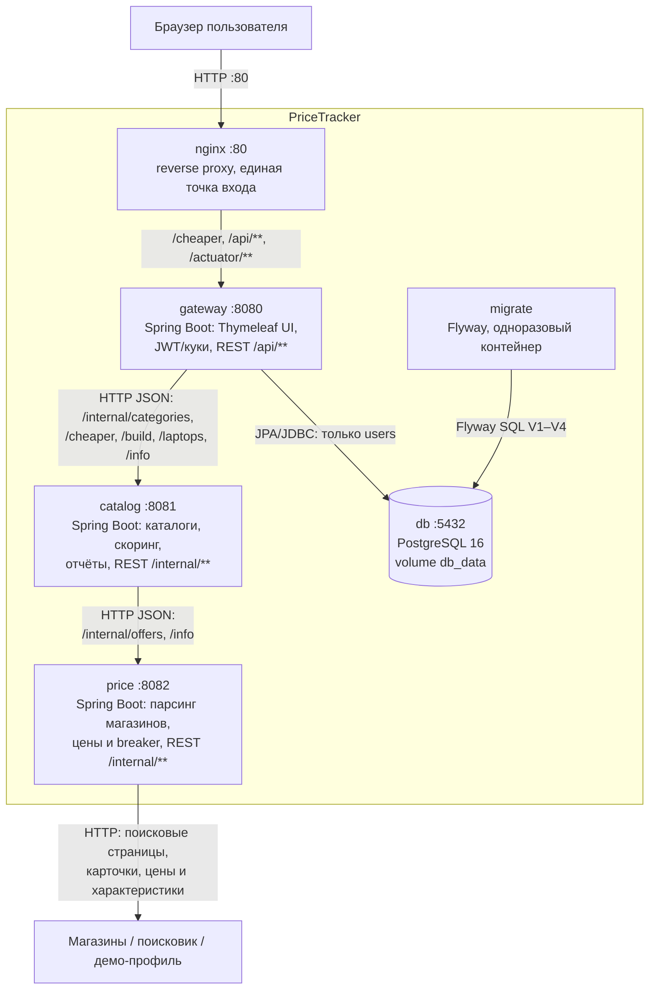
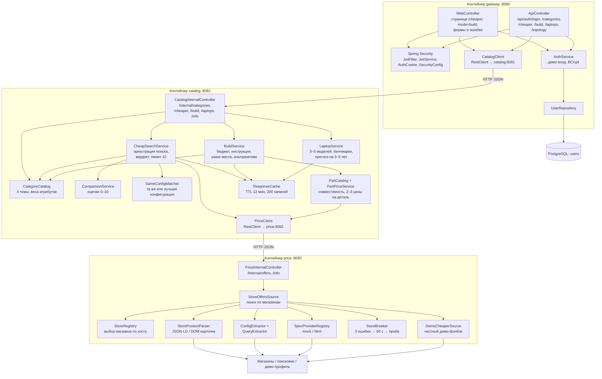

# C4-схемы PriceTracker

Три уровня, каждый описывает свою границу. Стрелка = вызов или поток данных.
Подсети `subgraph` показывают границу уровня. Подписи на стрелках — протокол или назначение.

Внутри системы три микросервиса: **gateway → catalog → price**. Они общаются по HTTP JSON,
а не вызовами методов в одном JVM-процессе.

---

## Уровень 1. Context — кто и зачем пользуется системой

**Как читать:** пользователь — единственный актор. Система — чёрный ящик с двумя режимами:
поиск дешевле по ссылке и локальная сборка ПК/ноутбука. Внешние системы — сайты магазинов
(DNS-Shop, М.Видео, Ситилинк, Ozon, Wildberries), Bing и демо-профиль.
Темы: ноутбуки, телефоны, наушники, сборки ПК.

---

## Уровень 2. Container — из каких приложений состоит система

**Как читать:** nginx — единственная публичная точка входа (`APP_PORT`, по умолчанию :80).
Порты 8081/8082 проброшены только для smoke-проверок и не проксируются nginx: внутренние
`/internal/**` недоступны снаружи. `migrate` завершается с кодом 0. PostgreSQL используется
только для демо-аккаунтов и JWT-входа; отчёты в БД не пишутся.
Зависимости заданы через `depends_on`: `price` (healthy) → `catalog` (healthy) → `gateway` (healthy) → `nginx`.

---

## Уровень 3. Component — внутреннее устройство трёх микросервисов

**Поиск дешевле.** `WebController`/`ApiController` через `CatalogClient` отправляют запрос в
`catalog`. `CheapSearchService` через `PriceClient` просит `price` найти карточки; `price`
определяет магазин по хосту (`StoreRegistry`), запрашивает поисковую страницу, разбирает
JSON-LD/DOM (`StoreProductParser`) и характеристики (`ConfigExtractor`). `SameConfigMatcher` в
`catalog` пропускает только комплектацию не хуже исходной и цену строго ниже. При блокировке
сайта `price` добавляет `warnings` и демо-карточки, а `catalog` считает баллы
(`ComparisonService.evaluate`) и вердикт. Результат не пишется в БД.

**Экспертный конфигуратор.** `BuildService` берёт веса из `CategoryCatalog`, распределяет
бюджет и подбирает детали из `PartCatalog`, проверяя сокет, чипсет, память, TDP, габариты и
запас мощности; предложения по деталям снова приходят из `price`. Отчёт включает обоснование,
инструкцию сборки, узкие места и альтернативу +12%. `LaptopService` сравнивает 3–5 конкретных
моделей с бенчмарками, автономностью, подводными камнями и прогнозом на 3–5 лет. Внешней
языковой модели нет: логика локальна и воспроизводима.

---

## Правила, по которым построены схемы

1. **Context** → только пользователь, система, внешние системы.
2. **Container** → только приложения/процессы и протоколы между ними.
3. **Component** → только классы внутри контейнеров; границы сервисов показаны `subgraph`.
4. Один и тот же элемент не переносится между уровнями: `nginx` только на Container,
   `JwtFilter` только на Component.
5. Стрелка всегда подписана тем, что именно передаётся: HTTP JSON, JDBC, карточки, цена, вердикт.

---

## Соответствие контейнеров папкам проекта

| Контейнер C4 | Папка | Dockerfile | Профиль / точка входа |
|---|---|---|---|
| nginx | `services/nginx` | `services/nginx/Dockerfile` | `nginx:1.27-alpine` |
| gateway | `services/gateway` | `services/gateway/Dockerfile` | `gateway`, `GatewayApplication` |
| catalog | `services/catalog` | `services/catalog/Dockerfile` | `catalog`, `CatalogApplication` |
| price | `services/price` | `services/price/Dockerfile` | `price`, `PriceApplication` |
| migrate | `services/migrate` | `services/migrate/Dockerfile` | `PriceTrackerApplication`, one-shot |
| db | `services/db` | `services/db/Dockerfile` | PostgreSQL 16 |

Все Java-контейнеры используют один JAR `pricetracker-1.0.0.jar`. Сервисы выбирают свой
`@SpringBootApplication` через `-Dloader.main=...` и `PropertiesLauncher`; `migrate` использует
обычный `java -jar`. Ограничение компонентного сканирования в каждом приложении не даёт
сервисами подхватить чужие бины (например, `price` не знает про доменную оценку).
