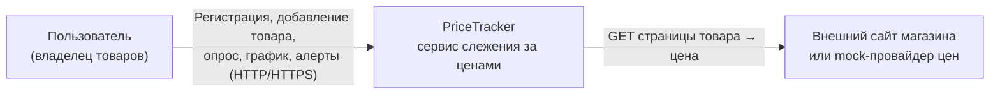
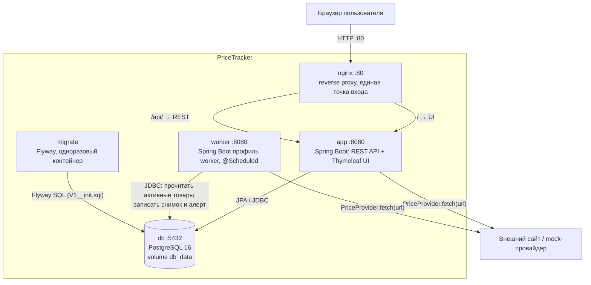
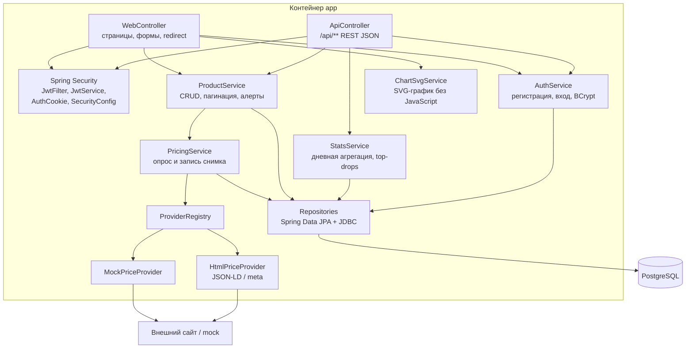
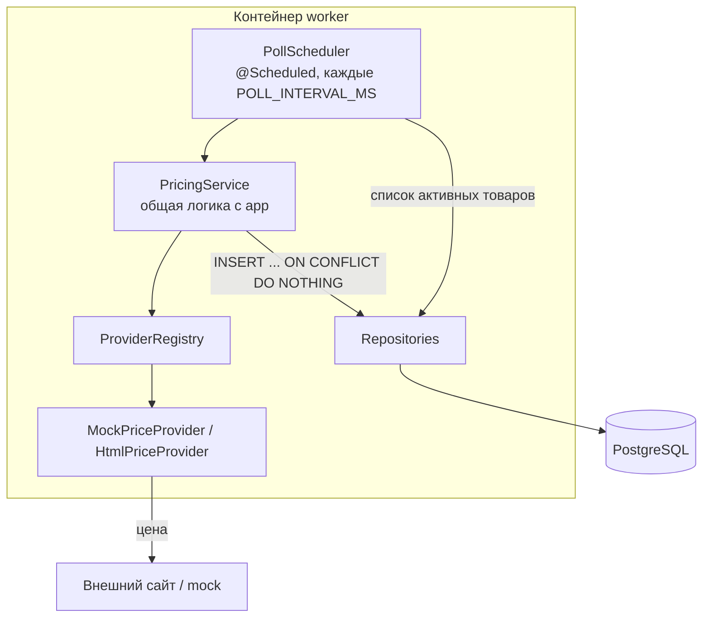

# C4-схемы PriceTracker

Три уровня, каждый описывает свою границу. Стрелка = вызов или поток данных.
Подсети `subgraph` показывают границу уровня. Подписи на стрелках — протокол или назначение.

---

## Уровень 1. Context — кто и зачем пользуется системой

**Как читать:** пользователь — единственный актор. Система — один чёрный ящик.
Внешняя система — источник цен. Внутреннее устройство на этом уровне не показывается.

---

## Уровень 2. Container — из каких приложений состоит система

**Как читать:** каждый прямоугольник — отдельный контейнер Docker/процесс.
nginx — единственный порт наружу. app и worker — один и тот же JAR с разными профилями.
migrate завершается с кодом 0 и не остаётся запущенным.
Все пишут в одну БД; обмен между контейнерами идёт через PostgreSQL и HTTP.

---

## Уровень 3. Component — внутреннее устройство контейнеров

### 3.1 Компоненты контейнера `app`

### 3.2 Компоненты контейнера `worker`

**Как читать:** на уровне Component показываются классы внутри одного контейнера.
`PricingService` существует в обоих контейнерах — это намеренное повторное использование одной логики,
а не смешивание уровней: в `app` он вызывается пользователем, в `worker` — планировщиком.

---

## Правила, по которым построены схемы

1. **Context** → только пользователь, система, внешние системы.
2. **Container** → только приложения/процессы и протоколы между ними.
3. **Component** → только классы внутри одного контейнера.
4. Один и тот же элемент не переносится между уровнями: `nginx` есть только на Container,
   `JwtFilter` — только на Component.
5. Стрелка всегда подписана тем, что именно передаётся: HTTP, JDBC, SQL, цена, снимок.

---

## Соответствие контейнеров папкам проекта

| Контейнер C4 | Папка | Dockerfile | Описание API |
|---|---|---|---|
| nginx | `services/nginx` | `services/nginx/Dockerfile` | `services/nginx/README.md` |
| app | `services/app` | `services/app/Dockerfile` | `services/app/README.md` |
| worker | `services/worker` | `services/worker/Dockerfile` | `services/worker/README.md` |
| migrate | `services/migrate` | `services/migrate/Dockerfile` | `services/migrate/README.md` |
| db | `services/db` | `services/db/Dockerfile` | `services/db/README.md` |

Исходный код Java общий для `app`, `worker` и `migrate`: это один JAR с разными профилями запуска.
Каждый профиль зашит в свой `Dockerfile` через `ENTRYPOINT`.
