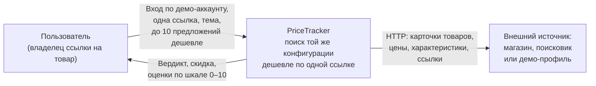
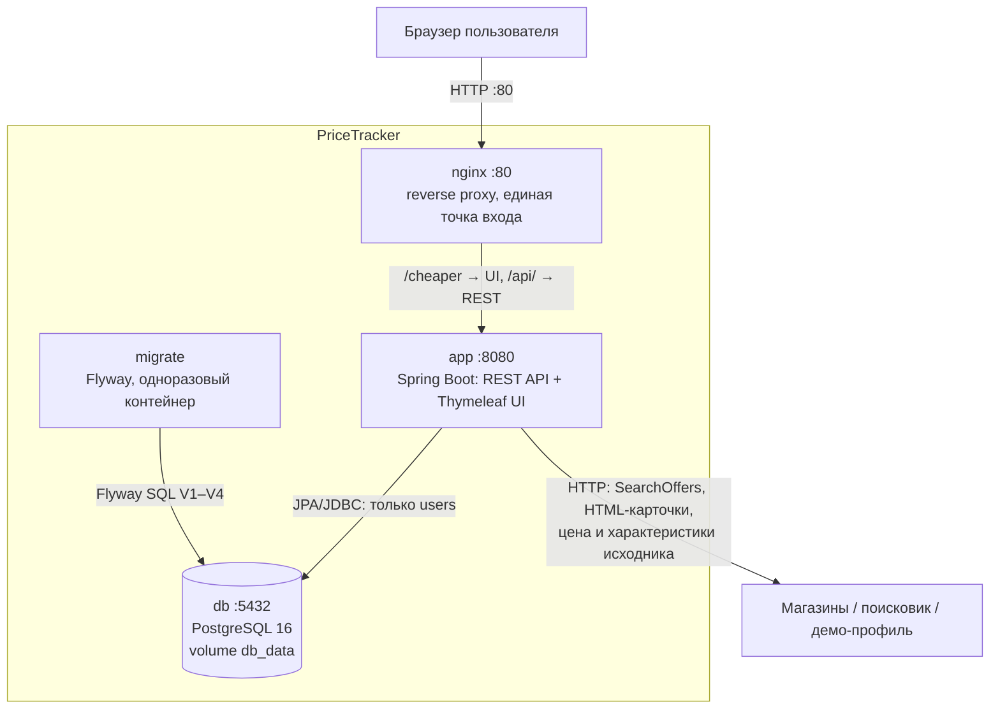
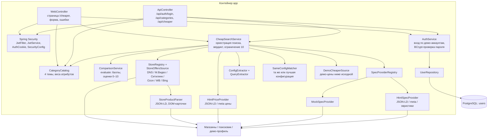

# C4-схемы PriceTracker

Три уровня, каждый описывает свою границу. Стрелка = вызов или поток данных.
Подсети `subgraph` показывают границу уровня. Подписи на стрелках — протокол или назначение.

---

## Уровень 1. Context — кто и зачем пользуется системой

**Как читать:** пользователь — единственный актор. Система — один чёрный ящик. Внешние
системы — сайты магазинов (DNS-Shop, М.Видео, Ситилинк, Ozon, Wildberries), Bing и демо-профиль.
Темы: ноутбуки, телефоны, наушники, сборки ПК.

---

## Уровень 2. Container — из каких приложений состоит система

**Как читать:** nginx — единственный порт наружу. `migrate` завершается с кодом 0.
Фонового воркера больше нет: поиск дешевле выполняется по запросу пользователя и ничего
не сохраняет в БД. PostgreSQL используется только для демо-аккаунтов и JWT-входа.

---

## Уровень 3. Component — внутреннее устройство контейнера `app`

**Поиск дешевле:** `CheapSearchService` определяет магазин по хосту (`StoreRegistry`),
запрашивает его поисковую страницу и, если включено, другие магазины (`StoreOffersSource`).
Карточки разбираются из JSON-LD/DOM (`StoreProductParser`), характеристики — из текста
(`ConfigExtractor`). `SameConfigMatcher` пропускает только комплектацию не хуже исходной
и цену строго ниже. При блокировке сайта подключается `DemoCheaperSource`; причина пишется
в `warnings`. `ComparisonService.evaluate` считает баллы, а интерфейс показывает оценки
конфигурации и цены/качества по шкале 0–10. Результат не пишется в БД.

---

## Правила, по которым построены схемы

1. **Context** → только пользователь, система, внешние системы.
2. **Container** → только приложения/процессы и протоколы между ними.
3. **Component** → только классы внутри одного контейнера.
4. Один и тот же элемент не переносится между уровнями: `nginx` только на Container,
   `JwtFilter` только на Component.
5. Стрелка всегда подписана тем, что именно передаётся: HTTP, JDBC, карточки, цена, вердикт.

---

## Соответствие контейнеров папкам проекта

| Контейнер C4 | Папка | Dockerfile | Описание API |
|---|---|---|---|
| nginx | `services/nginx` | `services/nginx/Dockerfile` | `services/nginx/README.md` |
| app | `services/app` | `services/app/Dockerfile` | `services/app/README.md` |
| migrate | `services/migrate` | `services/migrate/Dockerfile` | `services/migrate/README.md` |
| db | `services/db` | `services/db/Dockerfile` | `services/db/README.md` |

Исходный код Java общий для `app` и `migrate`: один JAR с разными профилями.
Профиль зашит в свой `Dockerfile` через `ENTRYPOINT`.
